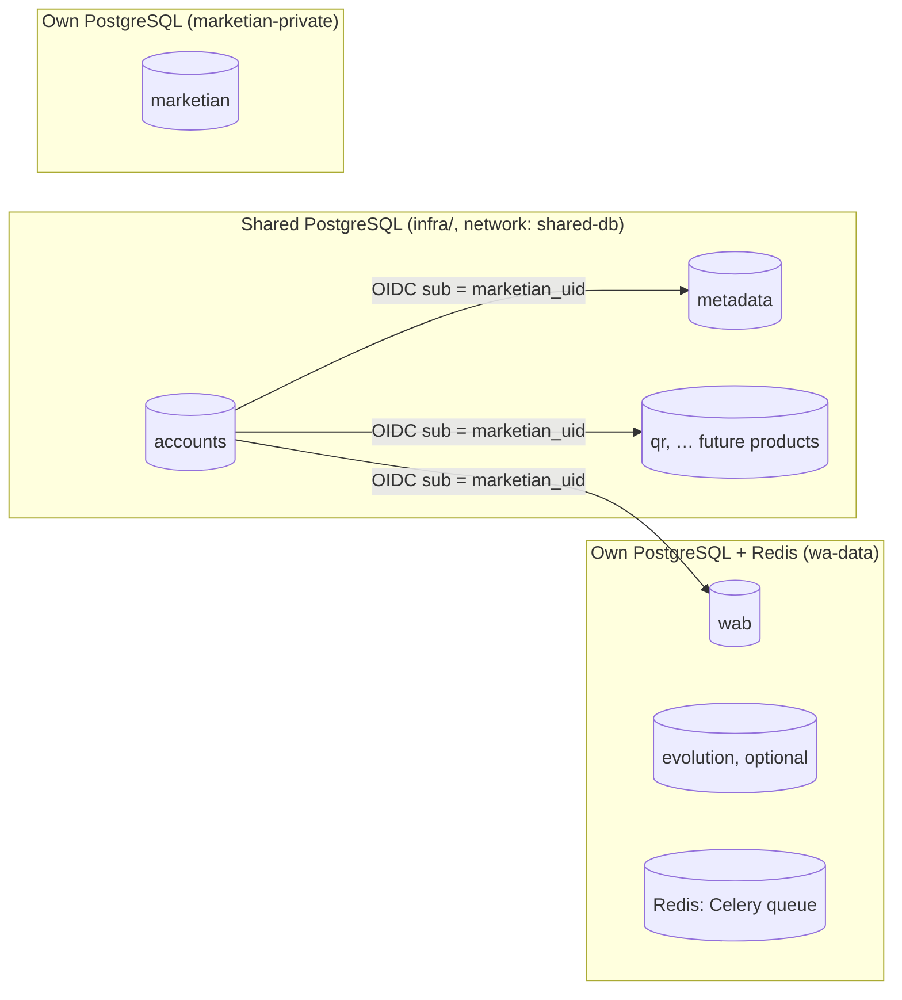
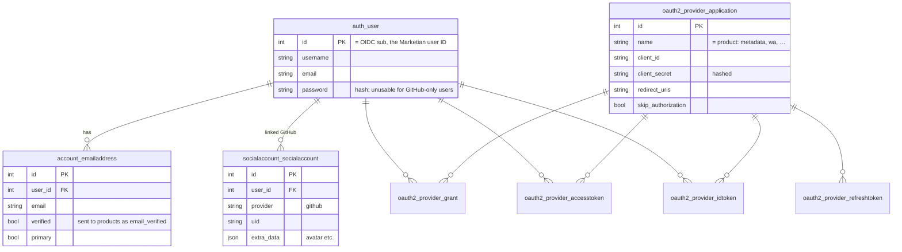
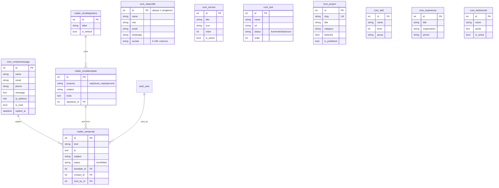
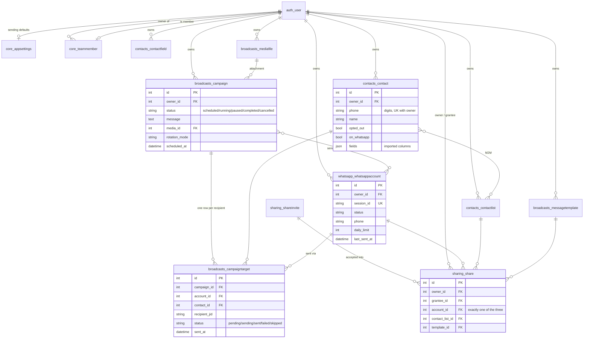
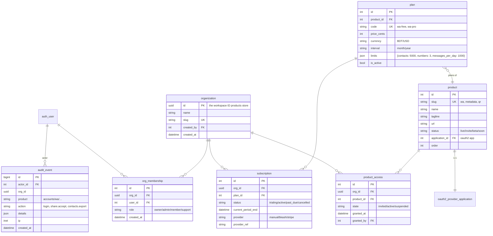
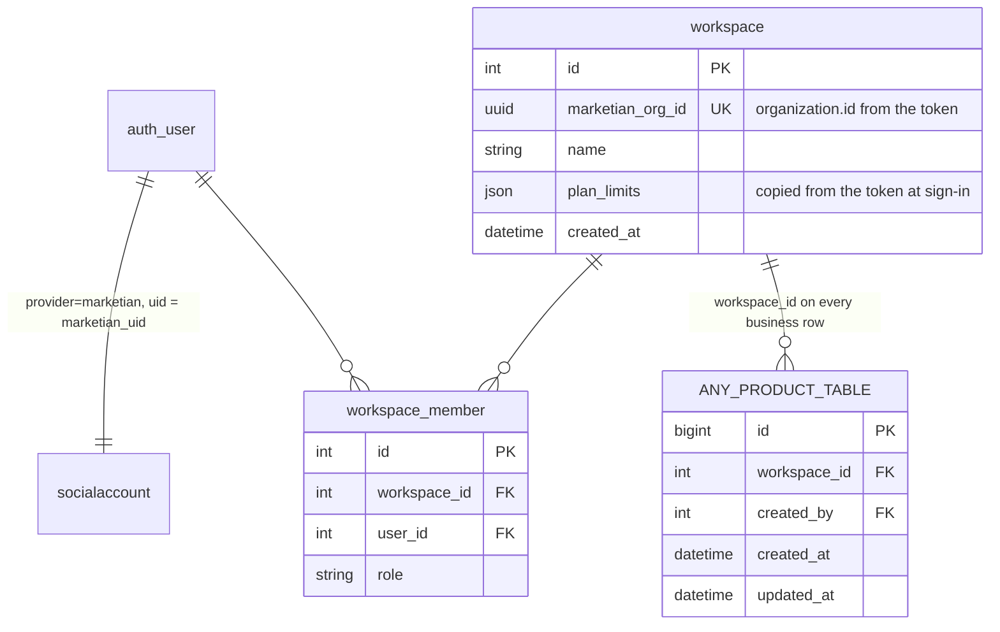

# Database design

As of: 2026-11-09. Status: **proposal for review**. Nothing here has been migrated yet.

This covers every database on the Marketian server: what exists today (read from the code), the target design, and the order to get there. The diagrams are Mermaid, and they render on GitHub and in VS Code with a Mermaid preview.

---

## 1. The big picture

**Rule 1: one database per app. Never share tables between apps.** Every site keeps its own database and its own login. Apps never join across databases or hold foreign keys into one another. The only thing that links them is the **Marketian user ID**, the OpenID Connect `sub` claim issued by accounts.marketian.net.



| Database | Server | Owner app | Holds | Sensitivity |
|---|---|---|---|---|
| `marketian` | own (`marketian-db`) | portfolio | site content, contact form messages, sent emails | Medium (visitor emails/phones) |
| `accounts` | shared (`postgres`) | accounts | **every user, password hash, GitHub link, product registrations, OIDC tokens** | **Highest** |
| `metadata` | shared | Metadata | users mirrored from accounts, product data (to be built) | Low–medium |
| `wab` | own (`wa-db`) | WA Broadcaster | contacts' phone numbers, campaigns, linked WhatsApp numbers | **High** (third-party personal data) |
| `evolution` | own (`wa-db`) | Evolution API (optional) | its own session data | High |

Why this split: see [03-decisions.md](03-decisions.md). In short, a breach or bad migration in one product can't touch another, each product can be backed up and restored on its own, and the WA Broadcaster's large, sensitive data stays off the shared server.

---

## 2. What exists today

### 2.1 `accounts`: the identity hub
All tables here come from libraries (Django auth, allauth, django-oauth-toolkit). The app adds no models of its own.



**A product = one row in `oauth2_provider_application`**, created by `manage.py register_product`.

### 2.2 `metadata`: product shell
Only library tables so far: `auth_user`, plus allauth `socialaccount_socialaccount` (provider `marketian`, `uid` = Marketian user ID) and `account_emailaddress`. There are no product tables yet.

### 2.3 `marketian`: the portfolio



### 2.4 `wab`: WA Broadcaster
A **workspace is a user**. Every business table has `owner_id → auth_user`, and team members point at their owner's user.



The current WA schema is solid: per-owner unique constraints, a check constraint on `Share`, and indexes on the hot queries (`campaign,status,position` and `account,status,sent_at`).

---

## 3. Gaps in today's design

| # | Gap | Where | Why it matters |
|---|---|---|---|
| G1 | **No central record of who may use which product.** Each product decides with its own `ALLOW_SIGNUP` env flag | accounts | You can't say "Arif can use WA, not Metadata" from one place, and the account page lists every product to everyone |
| G2 | **Products link users by email on first sign-in.** Later they rely on allauth's `socialaccount.uid` | WA, Metadata | Fine, but no product stores the Marketian ID on its own tables, so cross-product reporting is hard |
| G3 | **Workspace = user** | WA | A business can't have two owners, can't be renamed or transferred, and future products would each reinvent "team" |
| G4 | **No plans, limits or billing** | everywhere | Needed before any product is paid. Limits like "contacts per workspace" are hard-coded or absent |
| G5 | **`campaigntarget` grows without bound** (one row per message ever sent) | WA | Millions of rows within months. Slower reports and bigger backups |
| G6 | **No audit trail** of sign-ins, shares, exports or deletions | accounts, WA | Needed to investigate a misuse or a leaked number |
| G7 | **Opt-out is per workspace** (`contact.opted_out`) | WA | Someone who opts out from one workspace can still be messaged by another on the same server |
| G8 | **Portfolio's `core_tool` list is maintained by hand** | marketian | It can drift from the real product list in accounts |
| G9 | **No data retention rules** for contact messages, sent emails or WA media | marketian, WA | Personal data kept forever |

---

## 4. Target design

### 4.1 `accounts`: add a product catalog, organizations, access and billing
New app in `sites/accounts`, e.g. `portal` models. Each table is marked with the phase it arrives in.



How products use it:
- **New ID-token claims** (in `portal/oidc.py`): `orgs: [{id, name, role}]` and `products: ["wa", …]` for the orgs that have access. A product refuses sign-in if its slug isn't in `products`. This replaces each product's `ALLOW_SIGNUP` (fixes G1).
- **`product`** becomes the single list of products. The account page and the portfolio's "Marketing tools" page both read it: the portfolio fetches a small public JSON endpoint (`/api/products.json`) and caches it (fixes G8). `core_tool` can then be dropped, or kept only for the marketing copy.
- **`plan.limits`** is JSON so each product defines its own limits without a migration in accounts. Products receive the active plan's limits in the token, or fetch them from a `/api/orgs/<id>/entitlements` endpoint (fixes G4).
- **`audit_event`** gets sign-ins from accounts. Products send their own important events to it (fixes G6). It's append-only, and the plan is to keep 12 months.

### 4.2 Every product: the same three identity columns
Every product database follows one pattern, so a new product is copy-paste:



- **`workspace.marketian_org_id`** is the only link to accounts. It's a plain UUID, not a foreign key.
- Business rows hang off **`workspace_id`**, never off a user directly.
- Local `workspace` and `workspace_member` rows are created or updated **at every sign-in** from the token claims. That keeps them a cache of accounts, which stays the source of truth.

### 4.3 `wab`: move from "owner = user" to workspaces, and keep it fast

**Step A: introduce `core_workspace` (fixes G3, G2).**
- New `core_workspace(id, marketian_org_id uuid UK null, name, created_at)`.
- Data migration: one workspace per current owner user. Fill a new `workspace_id` on every table that has `owner_id`: contact, contactlist, contactfield, whatsappaccount, campaign, messagetemplate, mediafile, appsettings. `core_teammember` becomes `core_workspacemember(workspace_id, user_id, role)`, and the owner also gets a member row with role `owner`.
- Keep `owner_id` for one release (read-only), then drop it.
- `sharing_share.owner/grantee` → `owner_workspace_id / grantee_workspace_id`.
- Unique constraints move from `(owner, phone)` to `(workspace, phone)`, and likewise for the others.

**Step B: global opt-out (fixes G7).**
```
whatsapp_optout(
  phone       varchar(16) PK,   -- digits only, same format as contact.phone
  source      varchar(20),      -- 'reply_stop', 'manual', 'complaint'
  workspace_id int null,        -- who recorded it (for audit), not who it applies to
  created_at  timestamptz
)
```
The runner skips any target whose phone is in this table, whichever workspace sends. `contact.opted_out` stays as a per-workspace "don't send" flag.

**Step C: keep `campaigntarget` small (fixes G5, G9).**
- Add `broadcasts_campaignstats(campaign_id PK, total, sent, failed, skipped, first_sent_at, last_sent_at)`. Fill it when a campaign finishes, so reports read one row instead of counting targets.
- Retention job (a Celery beat task, nightly): for campaigns finished more than **90 days** ago, delete their `campaigntarget` rows after stats exist. Make 90 days a setting.
- Add index `campaigntarget(contact_id, sent_at)` for "last messaged" lookups in contact views.
- Revisit monthly partitioning of `campaigntarget` by `sent_at` only if it passes ~20M rows.

**Step D: indexes worth adding now** (cheap, matching existing query patterns):
- `contacts_contact (owner_id, opted_out, on_whatsapp)`, which becomes `(workspace_id, …)` after Step A: filters when building a campaign.
- `broadcasts_campaign (owner_id, status, scheduled_at)`: the beat task's "what's due" query and dashboard lists.
- `whatsapp_whatsappaccount (owner_id, status)`.

### 4.4 `metadata`: start on the standard pattern
Before building features, add `workspace` and `workspace_member` exactly as in 4.2. Every Metadata table then gets a `workspace_id` from day one, so it never needs the migration WA needs.

### 4.5 `marketian`: small changes
- `core_contactmessage`: add `deleted_at` (soft delete), and purge rows more than 2 years old (G9).
- `mailer_sentemail`: purge `body` and `html` after 1 year and keep the metadata row.
- `core_tool`: replace it with the accounts product feed, or keep it for marketing text only, linked by `product_slug` (G8).

---

## 5. Conventions (all databases)

| Topic | Rule |
|---|---|
| Engine | PostgreSQL 16 in production. SQLite only for local development, so don't use Postgres-only features without a fallback (or develop against Docker Postgres) |
| Names | Django defaults (`app_model`). Constraint names `unique_<what>_per_<scope>`, as WA already does |
| Keys | `bigint` auto IDs inside an app. **UUIDs only for IDs that cross apps** (organization). Never expose sequential IDs in public URLs (WA media already uses random tokens) |
| Time | `timestamptz`, stored in UTC. Display in `TIME_ZONE` (Asia/Dhaka). Every business table has `created_at`; editable ones also have `updated_at` |
| Phones | Digits only, international, no `+`, max 16 (E.164). One normaliser (`apps/contacts/phones.py`), used everywhere |
| Money | Integer minor units (`price_cents`) plus a `currency` column. Never floats |
| Flexible data | `JSONField` only for user-defined extras (contact fields, plan limits, audit details). Never for things you filter on often |
| Deletes | Business data: `on_delete=CASCADE` from workspace, `SET_NULL` for "who did it" columns (as now). Personal data: hard delete on request; history rows keep only IDs |
| Tenancy | Every query in a product is filtered by workspace. Enforce it in one base queryset or mixin, not by hand in each view |
| Migrations | One migration per change. Data migrations separate from schema migrations. Every migration must be reversible or say why not. Run `backup.sh` before deploying a migration (as the old WA project did with its `before-*.sql` dumps) |
| DB logins | Each app connects with its own Postgres role that owns only its database (`create-db.sh` does this). No app uses the `postgres` superuser |
| Backups | Nightly `scripts/backup.sh`, 14 days on the server, a copy downloaded off-server. Test a restore once per quarter |

---

## 6. Rollout order

| Phase | What | Databases touched | Risk |
|---|---|---|---|
| **0** (now) | Ship the current WA + Marketian sign-in as is (see [01-plan.md](01-plan.md)) | none new | Low |
| **1** | WA Step D indexes, WA Step B global opt-out, marketian retention fields | wab, marketian | Low: additive |
| **2** | accounts: `product`, `organization`, `org_membership`, `product_access`, `audit_event`. New ID-token claims. Each existing user gets a personal organization | accounts | Medium: test sign-in to every product |
| **3** | WA Step A (workspaces), driven by the new `orgs` claim. Metadata gets the same `workspace` tables | wab, metadata | **High**: back up first and rehearse on a copy of production data |
| **4** | WA Step C (stats + retention) | wab | Low |
| **5** | `plan`, `subscription` and entitlements, when the first product goes paid | accounts | Medium |

## 7. Open questions for you
1. **Workspaces:** should one person be able to own **several** workspaces (for example one per client)? The design allows it. If not, Phase 3 is simpler.
2. **Billing:** which payment method first: manual (you mark a subscription active), bKash, or a card processor? It changes only the `subscription.provider*` columns.
3. **Retention:** are 90 days of per-message WA history and 2 years of contact-form messages right for you?
4. **Metadata:** what will the product do? With that, I can design its tables on top of section 4.4.
