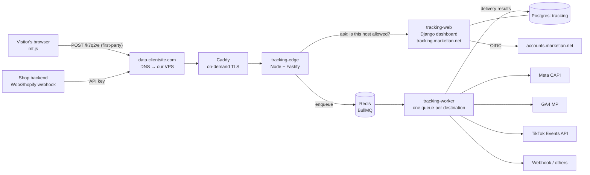
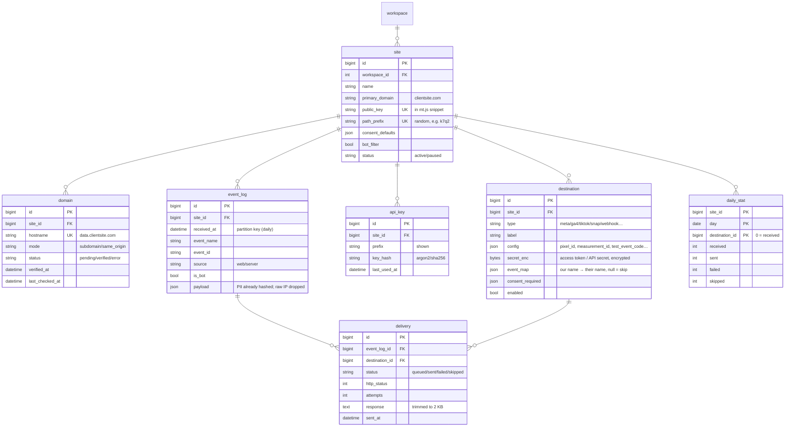

# Tracking product: server-side first-party tracking

As of: 2026-11-10. Status: **design, agreed direction, nothing built yet.** The detailed technical spec (exact tables, APIs, folders, build checklist) is in [06-tracking-build-spec.md](06-tracking-build-spec.md), and it wins wherever the two differ.

A Stape-style product for Marketian clients. The dashboard is at **tracking.marketian.net**. Each client site sends its events through **its own subdomain** (for example `data.clientsite.com`). The server sets first-party cookies there and forwards the events to Meta, GA4, TikTok and others.

Decisions behind this design (2026-11-10, see [03-decisions.md](03-decisions.md)):
- **Two kinds of domain.** One central dashboard, plus a custom subdomain for each client site.
- **Our own gateway, not hosted Google sGTM.** We write our own loader script, collector and forwarders, so there's no GTM container to run for each client. That's much lighter on the VPS, and every client shares one engine.
- **Agency clients first.** Arif sets clients up. Self-serve signup, plans and billing come later.
- **Same VPS for now.** The edge service is stateless, so it can move to a second "tracking node" later without code changes.

---

## 1. How Stape's features map to ours

| Stape | Marketian Tracking | Phase |
|---|---|---|
| sGTM container hosting | Built-in gateway (no GTM needed) | T1 |
| Custom domain (Entri / DNS) | Custom subdomain per site: DNS check, then automatic HTTPS (Caddy on-demand TLS) | T1 |
| Custom GTM/GA4 Loader | `mt.js` loader served from the client's domain under a random path that doesn't look like tracking | T1 |
| Meta CAPI / CAPI Gateway | Meta Conversions API forwarder (dedup with the browser pixel via `event_id`) | T1 |
| GA4 server-side | GA4 Measurement Protocol forwarder | T1 |
| Preview / debug | Live event log + per-destination response, Meta `test_event_code` | T1 |
| TikTok, Snapchat, Pinterest, LinkedIn tags | Forwarders, one at a time | T2–T3 |
| Cookie Keeper | Server-set, `HttpOnly` first-party ID cookie (`_mt_id`), plus server re-setting of `_fbp` / `_fbc` / `_ga` | T2 |
| Bot detection | User-agent lists + simple heuristics; bots dropped before forwarding | T2 |
| Geo / User Agent Info | Offline GeoLite2 lookup + UA parsing added to every event | T2 |
| Webhooks / backend events (Shopify, Woo) | Server-to-server endpoint for orders, refunds and leads, with an API key | T2 |
| Same Origin path | `clientsite.com/<path>/` proxied to us (Cloudflare Worker or Nginx snippet we generate) | T3 |
| Request analytics / monitoring | Daily stats per site and destination, alert e-mail when a destination keeps failing | T3 |
| CMS apps | WordPress/WooCommerce plugin that injects the loader and sends orders | T3 |
| Plans, billing | Uses accounts `plan` / `subscription` ([04-database-design.md](04-database-design.md) §4.1) | T4 |

**Google Ads** conversions need a Google Ads API developer token and OAuth for each client, so they're left out of T1. Until then, clients can import GA4 conversions into Google Ads.

---

## 2. Architecture



### Services (in `sites/tracking/`)
| Service | Tech | Job |
|---|---|---|
| `tracking-web` | Django + htmx (copied from `sites/metadata`) | Dashboard: sites, domains, destinations, event mapping, live log, stats. Marketian sign-in. Also serves `/internal/caddy-ask` and a config API for the edge |
| `tracking-edge` | Node 20 + Fastify (TypeScript) | Hot path. Serves `mt.js`, receives events, sets cookies, enriches, enqueues, then answers `204` in a few ms. Holds no state; reads site config from Redis cache |
| `tracking-worker` | Node (same codebase, BullMQ workers) | Turns each event into each platform's format, hashes PII, sends, retries with backoff, records the result |
| `tracking-redis` | Redis 7 | Queue + config cache. Internal network only |
| Database | Shared Postgres, database `tracking` | Config, logs, stats |

Node is used for the edge and worker because the WA gateway already uses it, and it handles many small HTTP requests well. Django stays for the dashboard, like every other site.

### Custom domains and HTTPS
1. In the dashboard, the client (or Arif) adds `data.clientsite.com` to a site.
2. The dashboard shows one DNS record: **CNAME `data` → `edge.marketian.net`** (or an A record to the VPS IP if their DNS can't CNAME). On Cloudflare it must be **DNS only (grey cloud)**.
3. A "Verify" button resolves the name. Once it points to us, the domain becomes `verified`.
4. Caddy has a catch-all site with **on-demand TLS**. Before issuing a certificate it calls `tracking-web` `/internal/caddy-ask?domain=…`, which answers 200 only for verified domains. This stops strangers from making us request certificates.

```caddy
{
    on_demand_tls {
        ask http://tracking-web:8000/internal/caddy-ask
    }
}
https:// {
    tls { on_demand }
    request_body { max_size 64KB }
    reverse_proxy tracking-edge:8080
}
```

**Subdomain naming:** advise clients to use a neutral name (`data.`, `m.`, `s.`, `go.`). Ad-block filter lists often match words like `tracking`, `pixel`, `analytics` and `collect` in hostnames and paths. For the same reason the loader and endpoint paths are random per site (for example `/k7q2/l.js`, `/k7q2/e`). The dashboard itself can stay at `tracking.marketian.net`, because it never loads on client sites.

### Safari / ITP: what the subdomain does and doesn't fix
- A first-party subdomain + server-set cookie gets past third-party cookie blocking, and past ad blockers that block `facebook.net` / `google-analytics.com`.
- **Safari (16.4+) still caps server-set cookies to 7 days when the server's IP address doesn't look like the main site's.** Our VPS IP won't match the client's host, so on Safari the subdomain mode alone gives at most 7 days. Phase T3's **same-origin path mode** (`clientsite.com/k7q2/…` proxied to us) solves this. It's the main reason to build it.

---

## 3. Event flow

1. `mt.js` (about 3 KB) loads from the client's subdomain. It reads/creates the visitor ID, collects page info and `fbclid` / `gclid` / `ttclid` / UTMs, and exposes `mt('track', 'Purchase', {...})`. It generates an `event_id` and also passes it to the browser pixel (`fbq(..., {eventID})`), so Meta can deduplicate.
2. The browser sends `POST /<path>/e` with `navigator.sendBeacon` (falls back to `fetch` with `keepalive`).
3. `tracking-edge`:
   - finds the site by `Host` (cached config); unknown host → 404
   - checks size, origin, rate limit per IP and per site
   - sets/refreshes `_mt_id` (`HttpOnly; Secure; SameSite=Lax; Domain=.clientsite.com`, 400 days); builds `_fbc` from `fbclid`; keeps `_fbp`
   - adds IP, user agent, geo, bot flag and consent state
   - drops bots and events without consent for that destination
   - pushes one job to Redis, answers `204`
4. `tracking-worker`, for each enabled destination that maps this event:
   - maps the event name (`Purchase` → Meta `Purchase`, GA4 `purchase`, TikTok `CompletePayment`)
   - normalises and **SHA-256 hashes** email, phone (same normaliser as WA: digits, international), name, city and zip as each platform requires
   - sends; on 5xx or timeout retries with backoff (5 tries over ~1 hour); a 4xx is final
   - writes the delivery result (status, HTTP code, a trimmed response)

**Consent.** `mt.js` accepts Google Consent Mode-style flags (`ad_storage`, `analytics_storage`, `ad_user_data`, `ad_personalization`). Each destination type declares which ones it needs. Without consent, the event is dropped for that destination, or for GA4 sent cookieless. The client stays responsible for having a consent banner. We're a processor.

---

## 4. Database (`tracking`)

Follows the standard product pattern in [04-database-design.md](04-database-design.md) §4.2: `workspace` + `workspace_member`, and every business row hangs off `workspace_id`.



- **Volume.** `event_log` and `delivery` grow fast. Partition them by day (`received_at`). Keep **14 days** of raw events (a setting) and drop old partitions nightly. `daily_stat` is kept forever and powers the charts. If one site passes ~5M events a month, move raw logs to ClickHouse. Postgres still holds config.
- **Secrets.** Platform tokens are encrypted with a key from `.env` (`TRACKING_SECRET_KEY`, Fernet in Django and the same scheme in Node). They're never shown again after saving, and never written to logs.
- **Edge config cache.** When a site, domain or destination changes, Django writes a compact JSON config into Redis (`site:host:<hostname>`). The edge reads only Redis, so the database can be down and collection keeps working.
- **No raw PII stored.** Email/phone are hashed before `event_log` is written. The IP is used for geo and forwarding, then stored only truncated (last octet zeroed).

---

## 5. Dashboard (tracking.marketian.net)

- **Sites:** list with today's events and destination health (green/amber/red).
- **Site → Setup:** the custom domain card (DNS record to add, Verify button, TLS status), and the install snippet (`<script>` with the site key and random path). Copy-ready snippets for GTM web, WordPress and Shopify.
- **Site → Destinations:** add Meta (Pixel ID + CAPI token + optional test code), GA4 (Measurement ID + API secret), TikTok (Pixel code + token), webhook. Event mapping table with defaults. "Send test event" button.
- **Site → Live log:** last 200 events streaming (htmx polling), click to see the payload and each destination's response. Same idea as Stape preview.
- **Site → Server events:** API keys and example `curl` for backend events (orders, refunds, leads).
- **Stats:** events per day per destination, failure rate, top events.

---

## 6. Ops and limits on the one VPS
- Expected footprint: edge ~80 MB, worker ~120 MB, Redis ~50–200 MB, dashboard ~150 MB. Fine on the current VPS for agency volumes.
- Caddy limits request bodies to 64 KB on client hosts. The edge rate-limits per IP (e.g. 60/min) and per site.
- Backups: `backup.sh` adds the `tracking` database, **excluding `event_log` / `delivery`** (only 14 days and large). The Redis queue isn't backed up.
- Monitoring: add `tracking.marketian.net` and one test client host to the uptime checks in [01-plan.md](01-plan.md).
- Moving to a second server later: run `tracking-edge` + `tracking-worker` + Redis there, point `edge.marketian.net` at it. Client DNS doesn't change, because they CNAME to `edge.marketian.net`. **That's why CNAME is the recommended record.**

---

## 7. Phases

| Phase | Scope | Done when |
|---|---|---|
| **T0** | This design. Register product `tracking` in accounts. Add `edge.marketian.net` DNS | Design agreed |
| **T1 (MVP)** | `sites/tracking` from `sites/metadata`; workspace tables; sites, domains (verify + on-demand TLS); `mt.js`; edge; worker; **Meta CAPI + GA4**; live log; tests | One real client site sends Purchase to Meta (dedup with pixel shows in Events Manager) and GA4 |
| **T2** | TikTok; server events API; cookie keeper (`_mt_id`, `_fbp`/`_fbc`/`_ga` refresh); bot filter; geo/UA enrichment; consent rules; retention job | 3 clients live, failures visible in the dashboard |
| **T3** | Same-origin path mode (Cloudflare Worker / Nginx snippet generator); WordPress/Woo plugin; Snapchat, Pinterest, LinkedIn; daily stats charts; failure alerts by e-mail | Safari cookies last beyond 7 days on a same-origin client |
| **T4** | Self-serve signup, plans with event quotas, billing (accounts `plan`/`subscription`) | First paying outside customer |

## 8. Open questions
1. **Product name** on the account page and portfolio: "Marketian Tracking", "Marketian Signal", something else?
2. **First client** for T1: which site, and does it run WooCommerce, Shopify or custom code? This decides which snippet and server-event example to build first.
3. **Raw log retention:** is 14 days enough for debugging, or do you want 30?
